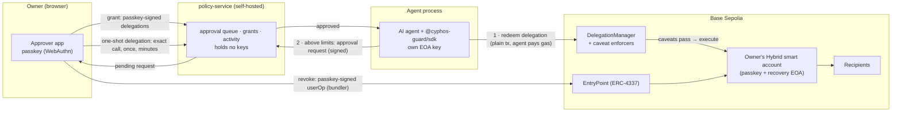
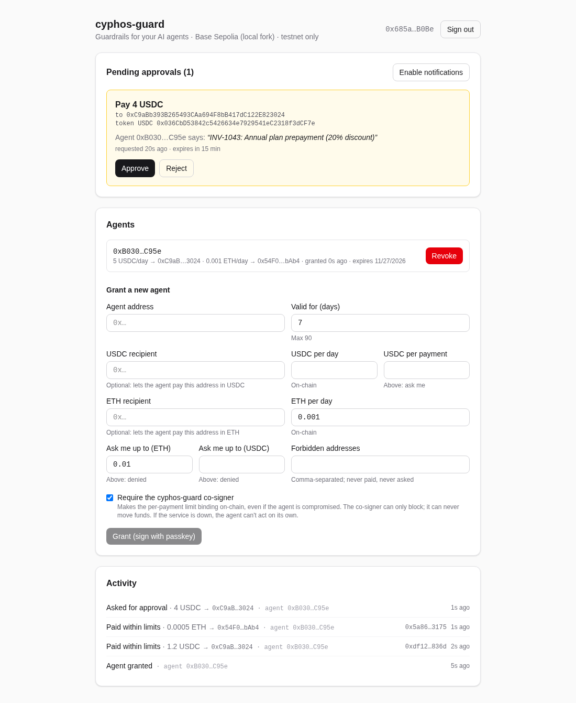
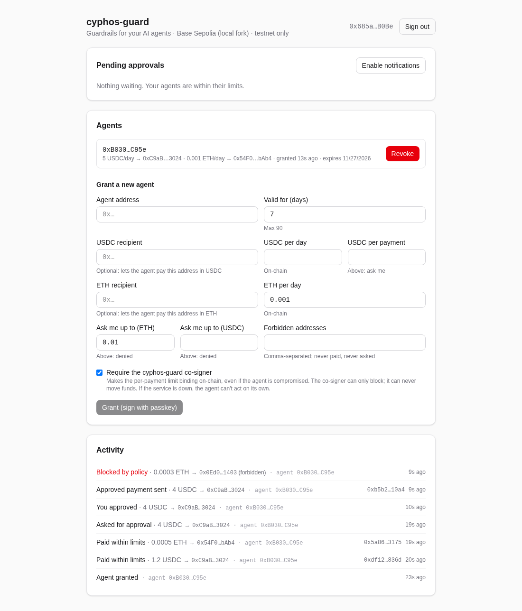

# cyphos-guard

**Guardrails and human approval for AI agents that spend crypto. Open source, self-hosted, testnet-first.**

Give an agent a budget it can't exceed, get a passkey prompt when it wants more, and make some things impossible.
All of it is enforced by your smart account, not by a server you have to trust.


> **Status:** working MVP on Base Sepolia (and local forks of it). **Testnet only. Not audited. Do not use with real funds.**

## The three layers

| Layer              | Example                                                        | What happens                                                                                                  |
| ------------------ | -------------------------------------------------------------- | ------------------------------------------------------------------------------------------------------------- |
| **Routine**        | Pay ≤ 2 USDC per invoice, ≤ 5 USDC a day, to your API provider | The agent pays alone. Limits are enforced **on-chain**                                                        |
| **Big or unusual** | A 4 USDC annual-plan invoice                                   | You get an approval request and approve with your **passkey** (Face ID, fingerprint, YubiKey). No seed phrase |
| **Forbidden**      | Paying a vendor on your denylist                               | Blocked. Never executed, never offered for approval                                                           |

## Quick start (5 minutes, no faucet, no API keys)

Requirements: Node ≥ 24, pnpm 12, [Foundry](https://getfoundry.sh) (for `anvil`), Chrome or Chromium.

```sh
pnpm install
pnpm poc     # proof of concept on a local Base Sepolia fork: limits, rejections, revoke, all on-chain
pnpm dev     # fork + policy service + approver → open http://localhost:3000
```

In the approver: **Create passkey → Create account → Grant a new agent**. Then let an agent use it:

```sh
pnpm demo:setup   # agent key + gas; prints a link that prefills the demo grant
pnpm demo:agent   # a Claude agent pays four invoices (needs ANTHROPIC_API_KEY in .env)
```

One run shows all three layers: two invoices paid alone, one approved by you with your passkey, one blocked by
your denylist ([demo details](examples/demo-agent/README.md), [video script](docs/demo-script.md)).

## Verified on Base Sepolia

The proof of concept (`NETWORK=live pnpm poc`) ran against live Base Sepolia on 2026-11-20. Every rejection
is a real transaction that the chain reverted; Basescan shows which caveat enforcer refused it.

| Step                                              | Result                                                         | Transaction                                                                                                                                                                                                  |
| ------------------------------------------------- | -------------------------------------------------------------- | ------------------------------------------------------------------------------------------------------------------------------------------------------------------------------------------------------------ |
| Owner's smart account (MetaMask Hybrid DeleGator) | deployed                                                       | [account](https://sepolia.basescan.org/address/0xBDCBf99882c8B1907d2D50B002b5442A909E39aC) · [deploy tx](https://sepolia.basescan.org/tx/0x8d45daa06ebaba7e97e0ebcf7f7b13f98681b6a219a061120ae247872a0a5054) |
| Grant: max 0.001 ETH/day, one recipient, 7 days   | signed off-chain (no gas)                                      | n/a                                                                                                                                                                                                          |
| Agent sends 0.0005 ETH                            | ✔ executed                                                     | [tx](https://sepolia.basescan.org/tx/0x2a80682ea8ceef5055348df41024e938186024fbbdf41425119322f3a4ef96d4)                                                                                                     |
| Agent sends 0.0006 ETH more (0.0011 for the day)  | ✘ `NativeTokenPeriodTransferEnforcer:transfer-amount-exceeded` | [reverted](https://sepolia.basescan.org/tx/0xe63575d7c35c7969f3c06d6f6d28bec51f111e2258a2465068c5d7a0f1635551)                                                                                               |
| Agent pays an address that isn't allowed          | ✘ `AllowedTargetsEnforcer:target-address-not-allowed`          | [reverted](https://sepolia.basescan.org/tx/0x5884582d3a6f8f039d37d41827abfadef98c31f3e74514daa6e6e1d41dcd6e55)                                                                                               |
| Agent attaches calldata to an allowed payment     | ✘ `ExactCalldataEnforcer:invalid-calldata`                     | [reverted](https://sepolia.basescan.org/tx/0x2169ba5984a34d531e5b54afa860e3062b0a5655eaf69bbcea0cbe2d7a5412af)                                                                                               |
| Owner revokes the grant                           | ✔ executed                                                     | [tx](https://sepolia.basescan.org/tx/0x4005499051f8fd8977a3ba6c511ed4c3ca387ae6fc3e7fbcaeacfe822ccb17e2)                                                                                                     |
| Agent tries again after revocation                | ✘ `CannotUseADisabledDelegation()`                             | [reverted](https://sepolia.basescan.org/tx/0x3539b22250cf502d8f21a4840f770d6548a51723cf67bbbe2ef1b7abb4875125)                                                                                               |

cyphos-guard's own **CosignerEnforcer** ([ADR 0005](docs/decisions/0005-cosigner-enforcer.md)) is deployed on Base Sepolia at
[`0x0a2f40e9789235B6ce2a23668FD3F90cef5eefbf`](https://sepolia.basescan.org/address/0x0a2f40e9789235B6ce2a23668FD3F90cef5eefbf)
([deploy tx](https://sepolia.basescan.org/tx/0x173932c273aa54d8d1751b2a1c646ba12c7fee64e8480e7869548d3523892b47)). It has the same address on every
chain, no owner and no upgrade path.

**Co-signer scenario** (`NETWORK=live pnpm poc:cosigner`, 2026-11-20). Grant: 0.001 ETH/day to one shop, with a co-signer.
The co-signer key signs exactly the typed data the policy service signs.
Account [0xd7a0…bD60](https://sepolia.basescan.org/address/0xd7a053F7d2063705FC0b5F84879331044Af6bD60).

| What the agent tried                                       | Result                                                         | Transaction                                                                                                    |
| ---------------------------------------------------------- | -------------------------------------------------------------- | -------------------------------------------------------------------------------------------------------------- |
| Send 0.0002 ETH with a fresh cosignature                   | ✔ executed                                                     | [tx](https://sepolia.basescan.org/tx/0x98c8fbcfb21e4ab4b2772d56767a4460e6589f686f09361e11aa1605d63ad071)       |
| Same payment without a cosignature (bypassing the service) | ✘ `CosignerEnforcer:missing-cosignature`                       | [reverted](https://sepolia.basescan.org/tx/0x74d20745be7b21a55ddf4634180db726b4f9ae3644adeb9069a8c5340b658041) |
| Cosignature forged with the agent's own key                | ✘ `CosignerEnforcer:invalid-cosignature`                       | [reverted](https://sepolia.basescan.org/tx/0x4fd3b0f4b1e4210d7ee18e3a9cd97fae202dc8744bbedf45ddc0875e589cb7d1) |
| Cosignature for 0.0002 used to send 0.0003                 | ✘ `CosignerEnforcer:invalid-cosignature`                       | [reverted](https://sepolia.basescan.org/tx/0x2da5e6a1f8d63b04e8994c4b5516bb405e68b19fcbc6cd95f512b9514ff98c2f) |
| Replaying the used cosignature                             | ✘ `CosignerEnforcer:already-used`                              | [reverted](https://sepolia.basescan.org/tx/0x0abed9c6a41f151e4d97dcaa6f13780396a46f045137b974368114974bdec4b8) |
| Expired cosignature                                        | ✘ `CosignerEnforcer:expired`                                   | [reverted](https://sepolia.basescan.org/tx/0x9cbe4bf88970cbfb55234e119422bdd943a5b2c2f006284ceec38e4b1288f902) |
| 0.0009 ETH with a valid cosignature (over the daily cap)   | ✘ `NativeTokenPeriodTransferEnforcer:transfer-amount-exceeded` | [reverted](https://sepolia.basescan.org/tx/0xc4808b32771c1e941adda5219b2a3b2e96748d9fbbe76cfb53ceb9ec27f0437b) |

**Approver app, live** (`pnpm --filter @cyphos-guard/approver e2e:live`, 2026-11-20). The real UI in Chromium with a virtual
passkey: the passkey-only account was created through the public Pimlico bundler, then granted a co-signed 0.0005 ETH/day
permission. Account [0x408a…cEEB](https://sepolia.basescan.org/address/0x408a4835F92C8d5fd173769a08BB4C26B584cEEB).

| Step                                                                      | Result                                         | Transaction                                                                                              |
| ------------------------------------------------------------------------- | ---------------------------------------------- | -------------------------------------------------------------------------------------------------------- |
| Agent pays 0.0002 ETH alone (co-signed)                                   | ✔ executed                                     | [tx](https://sepolia.basescan.org/tx/0x69754a60214bd1544edce679afcc7cac6c5ac275617d2f582ab1e88dc3490059) |
| Agent wants 0.0006 ETH (over the daily cap) → owner approves with passkey | ✔ executed after approval                      | [tx](https://sepolia.basescan.org/tx/0x48275c3c2449841416d064b660a09eb2d0eb620b8502b837ab4afd4642d3e48c) |
| Owner clicks Revoke (passkey-signed userOp via bundler)                   | ✔ revoked; the agent's next attempt is refused | [tx](https://sepolia.basescan.org/tx/0x8ee0aa16145b38a0f260cdcc2b0e16901f67faae23296cf95290d599c900bbee) |

The demo agent was also run with the real Claude model (`claude-opus-5-5`, `pnpm demo:selftest`, on a local
Base Sepolia fork). It paid the two routine invoices alone, waited for the owner's passkey approval on the 4 USDC
invoice, and was blocked when it tried to pay the denylisted vendor. On-chain balances confirmed each outcome.

## Use it from your agent

### Create the agent's key

The agent has its own key pair. The agent's developer creates it where the agent runs and gives the **owner only the
address**. cyphos-guard never sees the key, and the key holds no owner funds (just a little gas):

```sh
pnpm cli agent new --env agent.env --approver https://your-approver.example
#   Agent address  0x9520…0b01      ← give this to the owner, who grants it limits with their passkey
#   Private key    stored in agent.env as CYPHOS_AGENT_PRIVATE_KEY (mode 600, never printed)
pnpm cli agent show --env agent.env   # address + gas balance
```

It refuses to overwrite an existing key (`--force` replaces it and prints the old address) and warns if the file is in
a git repo but not ignored. For production, a KMS or server-wallet key works just as well: only its address matters.

### Call the SDK

```ts
import { createCyphosGuard, ApprovalPending, PolicyViolation } from "@cyphos-guard/sdk";

const pw = createCyphosGuard({ policyServiceUrl, agent: privateKeyToAccount(AGENT_KEY) });

try {
  const { txHash } = await pw.execute({ to: vendor, value: parseEther("0.0005"), reason: "GPU credits" });
} catch (e) {
  if (e instanceof ApprovalPending)
    await pw.waitForApproval(e.request.id); // owner approves with passkey
  else if (e instanceof PolicyViolation)
    console.log("not allowed:", e.reason); // forbidden / over_hard_max / no_grant
  else throw e;
}
```

[SDK quickstart & API reference](packages/sdk/README.md) · [policy examples](docs/policy-examples.md)

### …or from any MCP agent

The [cyphos-guard MCP server](packages/mcp/README.md) gives Claude Code, Claude Desktop and other MCP clients the tools
`get_wallet_status`, `pay`, `call_contract`, `fetch_paid_api` (x402), `check_approval` and `list_activity`. They're
backed by the same three layers:

```sh
claude mcp add cyphos-guard -e CYPHOS_AGENT_PRIVATE_KEY=0x… -- node /path/to/cyphos-guard/packages/mcp/src/server.ts
```

### …and pay x402 APIs

[x402](https://docs.x402.org) lets APIs charge per request over HTTP 402. With an `x402` permission, the agent pays
allowed sellers within your limits, asks you above them, and never pays a forbidden seller:

```ts
const { response, paid } = await pw.payX402("https://api.example/report", {}, { reason: "weekly market report" });
```

How it works: an x402 payment must be signed by the payer, and only your passkey can sign for your account. So each
payment moves exactly the price from your account to the agent's own address (on-chain: only to the agent, capped per
period, per-payment cap binding via the co-signer), and the agent immediately signs the x402 payment to the seller.

| Rule                                                   | Enforced                                                                                                                                                   |
| ------------------------------------------------------ | ---------------------------------------------------------------------------------------------------------------------------------------------------------- |
| Total x402 spend per period, top-ups only to the agent | on-chain                                                                                                                                                   |
| Per-payment cap                                        | on-chain via the co-signer (required for x402)                                                                                                             |
| Which sellers may be paid                              | SDK + co-signer. The last hop (agent → seller) is signed by the agent alone, so a **stolen agent key could redirect at most what the on-chain caps allow** |

Verified against the official x402 server and facilitator (`@x402/core` / `@x402/evm` 2.30) on a Base Sepolia fork:
routine payment, escalation with approval, forbidden seller, max-amount guard
([test](examples/x402-seller/src/x402.fork.test.ts)). When x402's delegation-based transfer method (ERC-7710) is
supported by facilitators, the last hop can move on-chain too.

## How it works



- Your account is a **MetaMask Hybrid smart account** owned by your passkey, with an optional recovery EOA.
- A grant is a set of **delegations** (ERC-7710, [MetaMask Delegation Framework](https://github.com/MetaMask/delegation-framework),
  audited). Each carries on-chain **caveats**: recipients, functions, per-tx and per-period caps, expiry.
- The agent redeems delegations with **ordinary transactions from its own key**. No bundler, and it can't drain
  your account through gas.
- Above its limits, the SDK files an **approval request**. Your passkey signs a **one-shot delegation**: exactly
  that call, usable once, valid for minutes. It can't be replayed or widened.
- **Hybrid enforcement.** Hard caps live on-chain. The policy service only refuses or escalates: it holds no key that
  can move funds, can't widen a grant, and isn't needed to revoke.
- **Optional co-signer** ([ADR 0005](docs/decisions/0005-cosigner-enforcer.md)). cyphos-guard's own `CosignerEnforcer` makes
  the rules the chain can't express (ERC-20 per-payment caps, range checks) binding: each redemption needs a fresh
  co-signature for that exact call, and the service only co-signs within policy. The co-signer can only block.

Design records: [account stack](docs/decisions/0001-account-stack.md) ·
[policy schema](docs/decisions/0002-policy-schema.md) ·
[owner actions](docs/decisions/0003-owner-actions-without-bundler.md) ·
[approval flow & trust model](docs/decisions/0004-approval-flow.md) ·
[co-signer](docs/decisions/0005-cosigner-enforcer.md) · [security](SECURITY.md)

| Pending approval (decoded locally from what will be signed)                                       | Activity after the demo run                                                                   |
| ------------------------------------------------------------------------------------------------- | --------------------------------------------------------------------------------------------- |
|  |  |

## What is the co-signer?

The co-signer is an optional second signature that cyphos-guard adds to every payment an agent makes. Think of a
bank that requires two signatures on a cheque, except that the second signer can only say "no", never "yes" on its own.

**The problem it solves.** An agent's limits come in two kinds:

- **Limits the smart contracts enforce directly**, such as "max 5 USDC per day" or "only pay this address". The
  blockchain refuses anything outside them, whatever the agent does.
- **Limits the contracts can't express**, such as "max 2 USDC _per payment_" for tokens, or "amount must be below X".
  Without the co-signer only the SDK checks these, inside the agent's own program. A hacked or buggy agent could skip
  the SDK and use its signed permission directly, and the blockchain would let the payment through.

**How it fixes that**

1. You grant an agent permissions with the co-signer turned on (the "Require the cyphos-guard co-signer" checkbox in
   the approver). The permission then says that every payment also needs a fresh signature from the co-signer.
2. Before each payment, the agent asks the cyphos-guard policy service to co-sign it.
3. The service checks the payment against all the rules, including the ones the contracts can't express, and only
   signs if everything is fine.
4. The agent attaches the signature and sends the payment. cyphos-guard's own smart contract, the
   [`CosignerEnforcer`](packages/contracts/src/CosignerEnforcer.sol), checks on-chain that the signature is genuine,
   fresh and for exactly this payment.

A hacked agent that tries to skip the rules fails on-chain because it has no valid co-signature (see the
[live co-signer scenario](#verified-on-base-sepolia) above: `missing-cosignature`, `invalid-cosignature` and so on).

**Why it's safe.** The co-signer **can only block, never move money.** Its signature alone does nothing: a payment
still needs the agent's key and your passkey-signed permission, and every on-chain limit still applies. In the live
test, a valid co-signature couldn't get past the daily cap. If the co-signer key were ever stolen, the worst case is
that the extra rules stop working; your on-chain limits still hold.

**The trade-off.** If the policy service is down, a co-signed agent can't make payments on its own until it's back.
Your approvals and revocations keep working. That's why it's a checkbox: you choose between stricter safety and
independence from the service. Design details: [ADR 0005](docs/decisions/0005-cosigner-enforcer.md).

## Why cyphos-guard

cyphos-guard builds on the same primitive as MetaMask's Advanced Permissions, the Delegation Framework, and adds
the parts an agent operator needs around it.

|                         | **cyphos-guard**                                                                         | **MetaMask Advanced Permissions** (ERC-7715)                                     | **Fireblocks Agent Wallets**                                                  |
| ----------------------- | ---------------------------------------------------------------------------------------- | -------------------------------------------------------------------------------- | ----------------------------------------------------------------------------- |
| Built for               | Indie devs and small teams running their own agents                                      | Dapps and agents requesting permissions from MetaMask users                      | Fintechs and payment providers issuing wallets to their end users             |
| Owner's side            | A browser and a passkey                                                                  | MetaMask extension (v13.23+) and an account upgraded to a MetaMask smart account | Wallets issued by the fintech on the Fireblocks platform (powered by Dynamic) |
| Custody                 | Non-custodial smart account (passkey + optional recovery EOA)                            | User's MetaMask smart account                                                    | Users keep custody via MPC key management (per Fireblocks)                    |
| Limits                  | On-chain caveats: per-tx / per-period caps, recipients, functions, argument pins, expiry | Spending and periodic permissions granted up front in the extension              | Policy engine checks agent transactions before signing                        |
| Above the limit         | **Live escalation**: request → passkey approval → one-shot delegation                    | Not part of ERC-7715 itself (it defines permission requests)                     | Policy-engine rules (see Fireblocks docs)                                     |
| Forbidden actions       | Denylist + hard maximums; never escalated                                                | Whatever the granted permission excludes                                         | Policy-engine rules                                                           |
| Open source / self-host | Yes (Apache-2.0), self-hosted service + app                                              | SDK and contracts open source; the extension is MetaMask's                       | Commercial platform                                                           |

Sources: [MetaMask Advanced Permissions docs](https://docs.metamask.io/smart-accounts-kit/concepts/advanced-permissions/),
[MetaMask support: Advanced Permissions](https://support.metamask.io/more-web3/dapps/advanced-permissions/),
[Fireblocks agentic infrastructure](https://www.fireblocks.com/solutions/agentic-digital-asset-infrastructure),
[Fireblocks Agentic Payments Suite](https://fireblocks.com/blog/agentic-payments-suite-psp-fintech) (checked November 2026;
corrections welcome).

## Roadmap

**Done recently**

- **MCP server** ([packages/mcp](packages/mcp/README.md)). Any MCP-capable agent can pay under cyphos-guard's rules.

- **Live Base Sepolia guide** ([docs/live-guide.md](docs/live-guide.md)). The full approver flow runs on live Base Sepolia.

- **Co-signer enforcer** ([ADR 0005](docs/decisions/0005-cosigner-enforcer.md)). An optional caveat that requires a fresh
  policy-service signature per redemption. It makes ERC-20 per-payment caps and range checks on arguments binding
  even for a compromised agent, while the co-signer still can't move funds.

- **x402**: agents pay HTTP 402 APIs within your limits (`payX402`, MCP `fetch_paid_api`).

**Next**

- Several ERC-20 recipients per permission (`LogicalOrWrapperEnforcer`), batch approvals, web push notifications.
- Gasless revoke through a paymaster, plus a pinned or IPFS approver build so you don't have to trust a host.

**Smart rules**

- Swap guardrails: max slippage, allowed pools and tokens.
- Market and protocol risk: pause on APY swings, depegs or protocol incidents.
- Anomaly detection on agent behavior: unusual rate, new counterparties, off-hours spending, with automatic escalation.

**Wider support**

- Wallet-agnostic adapters behind the same policy schema (e.g. ERC-7579 smart sessions, ZeroDev Kernel).

**Not planned:** a token, a DAO, or mainnet before an independent audit.

## Repo layout

```
apps/approver         Next.js owner app: passkey login, approvals, grants, revoke, activity
apps/policy-service   approval queue · grant registry · activity (Hono + node:sqlite), holds no keys
packages/cli          cyphos-guard CLI: `agent new` / `agent show` (agent key, kept by the agent's developer)
examples/x402-seller  x402 seller on the official x402 server logic (tests, live demo)
packages/contracts    CosignerEnforcer (Foundry, on Delegation Framework v1.3.0 as submodule)
packages/mcp          MCP server (pay, check_approval, … for Claude Code / Claude Desktop)
packages/sdk          @cyphos-guard/sdk: createCyphosGuard, policy compiler, co-signer, typed errors
packages/shared       policy schema (zod), API types, escalation and off-chain checks
examples/poc          Phase 1 proof of concept + passkey spike + e2e escalation flow
examples/demo-agent   Claude accounts-payable agent (Messages API tool runner)
docs/                 ADRs, policy examples, demo script, assets
```

## Development

```sh
git submodule update --init --recursive      # once, for packages/contracts
pnpm lint && pnpm typecheck && pnpm test     # offline
pnpm contracts:test                          # Foundry tests
pnpm test:fork                               # SDK integration tests on a fork
pnpm e2e && pnpm demo:selftest --fake-model  # end-to-end flows on a fork
pnpm e2e:browser && pnpm e2e:demo            # approver in Chromium with a virtual passkey
```

See [CONTRIBUTING.md](CONTRIBUTING.md). Commits are scanned for secrets (pre-commit hook + gitleaks).

## License

[Apache License 2.0](LICENSE).
