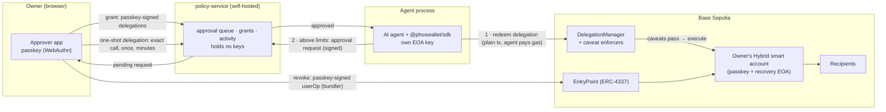

# phoswallet

**Guardrails and human approval for AI agents that spend crypto. Open source, self-hosted, testnet-first.**

Give an agent a budget it can't exceed, get a passkey prompt when it wants more, and make some things impossible.
All of it is enforced by your smart account, not by a server you have to trust.


> **Status:** working MVP on Base Sepolia (and local forks of it). **Testnet only. Not audited. Do not use with real funds.**

## The three layers

| Layer              | Example                                                        | What happens                                                                                                  |
| ------------------ | -------------------------------------------------------------- | ------------------------------------------------------------------------------------------------------------- |
| **Routine**        | Pay ≤ 2 USDC per invoice, ≤ 5 USDC a day, to your API provider | The agent pays alone. Limits are enforced **on-chain**                                                        |
| **Big or unusual** | A 4 USDC annual-plan invoice                                   | You get an approval request and approve with your **passkey** (Face ID, fingerprint, YubiKey). No seed phrase |
| **Forbidden**      | Paying a vendor on your denylist                               | Blocked. Never executed, never offered for approval                                                           |

## Quick start (5 minutes, no faucet, no API keys)

Requirements: Node ≥ 24, pnpm 12, [Foundry](https://getfoundry.sh) (for `anvil`), Chrome or Chromium.

```sh
pnpm install
pnpm poc     # proof of concept on a local Base Sepolia fork: limits, rejections, revoke, all on-chain
pnpm dev     # fork + policy service + approver → open http://localhost:3000
```

In the approver: **Create passkey → Create account → Grant a new agent**. Then let an agent use it:

```sh
pnpm demo:setup   # agent key + gas; prints a link that prefills the demo grant
pnpm demo:agent   # a Claude agent pays four invoices (needs ANTHROPIC_API_KEY in .env)
```

One run shows all three layers: two invoices paid alone, one approved by you with your passkey, one blocked by
your denylist ([demo details](examples/demo-agent/README.md), [video script](docs/demo-script.md)).

## Verified on Base Sepolia

The proof of concept (`NETWORK=live pnpm poc`) ran against live Base Sepolia on 2026-11-20. Every rejection
is a real transaction that the chain reverted; Basescan shows which caveat enforcer refused it.

| Step                                              | Result                                                         | Transaction                                                                                                                                                                                                  |
| ------------------------------------------------- | -------------------------------------------------------------- | ------------------------------------------------------------------------------------------------------------------------------------------------------------------------------------------------------------ |
| Owner's smart account (MetaMask Hybrid DeleGator) | deployed                                                       | [account](https://sepolia.basescan.org/address/0xBDCBf99882c8B1907d2D50B002b5442A909E39aC) · [deploy tx](https://sepolia.basescan.org/tx/0x8d45daa06ebaba7e97e0ebcf7f7b13f98681b6a219a061120ae247872a0a5054) |
| Grant: max 0.001 ETH/day, one recipient, 7 days   | signed off-chain (no gas)                                      | n/a                                                                                                                                                                                                          |
| Agent sends 0.0005 ETH                            | ✔ executed                                                     | [tx](https://sepolia.basescan.org/tx/0x2a80682ea8ceef5055348df41024e938186024fbbdf41425119322f3a4ef96d4)                                                                                                     |
| Agent sends 0.0006 ETH more (0.0011 for the day)  | ✘ `NativeTokenPeriodTransferEnforcer:transfer-amount-exceeded` | [reverted](https://sepolia.basescan.org/tx/0xe63575d7c35c7969f3c06d6f6d28bec51f111e2258a2465068c5d7a0f1635551)                                                                                               |
| Agent pays an address that isn't allowed          | ✘ `AllowedTargetsEnforcer:target-address-not-allowed`          | [reverted](https://sepolia.basescan.org/tx/0x5884582d3a6f8f039d37d41827abfadef98c31f3e74514daa6e6e1d41dcd6e55)                                                                                               |
| Agent attaches calldata to an allowed payment     | ✘ `ExactCalldataEnforcer:invalid-calldata`                     | [reverted](https://sepolia.basescan.org/tx/0x2169ba5984a34d531e5b54afa860e3062b0a5655eaf69bbcea0cbe2d7a5412af)                                                                                               |
| Owner revokes the grant                           | ✔ executed                                                     | [tx](https://sepolia.basescan.org/tx/0x4005499051f8fd8977a3ba6c511ed4c3ca387ae6fc3e7fbcaeacfe822ccb17e2)                                                                                                     |
| Agent tries again after revocation                | ✘ `CannotUseADisabledDelegation()`                             | [reverted](https://sepolia.basescan.org/tx/0x3539b22250cf502d8f21a4840f770d6548a51723cf67bbbe2ef1b7abb4875125)                                                                                               |

The demo agent was also run with the real Claude model (`claude-opus-5-5`, `pnpm demo:selftest`, on a local
Base Sepolia fork). It paid the two routine invoices alone, waited for the owner's passkey approval on the 4 USDC
invoice, and was blocked when it tried to pay the denylisted vendor. On-chain balances confirmed each outcome.

## Use it from your agent

```ts
import { createPhoswallet, ApprovalPending, PolicyViolation } from "@phoswallet/sdk";

const pw = createPhoswallet({ policyServiceUrl, agent: privateKeyToAccount(AGENT_KEY) });

try {
  const { txHash } = await pw.execute({ to: vendor, value: parseEther("0.0005"), reason: "GPU credits" });
} catch (e) {
  if (e instanceof ApprovalPending)
    await pw.waitForApproval(e.request.id); // owner approves with passkey
  else if (e instanceof PolicyViolation)
    console.log("not allowed:", e.reason); // forbidden / over_hard_max / no_grant
  else throw e;
}
```

[SDK quickstart & API reference](packages/sdk/README.md) · [policy examples](docs/policy-examples.md)

## How it works



- Your account is a **MetaMask Hybrid smart account** owned by your passkey, with an optional recovery EOA.
- A grant is a set of **delegations** (ERC-7710, [MetaMask Delegation Framework](https://github.com/MetaMask/delegation-framework),
  audited). Each carries on-chain **caveats**: recipients, functions, per-tx and per-period caps, expiry.
- The agent redeems delegations with **ordinary transactions from its own key**. No bundler, and it can't drain
  your account through gas.
- Above its limits, the SDK files an **approval request**. Your passkey signs a **one-shot delegation**: exactly
  that call, usable once, valid for minutes. It can't be replayed or widened.
- **Hybrid enforcement.** Hard caps live on-chain. The policy service only refuses or escalates: it holds no key that
  can move funds, can't widen a grant, and isn't needed to revoke.
- **Optional co-signer** ([ADR 0005](docs/decisions/0005-cosigner-enforcer.md)). phoswallet's own `CosignerEnforcer` makes
  the rules the chain can't express (ERC-20 per-payment caps, range checks) binding: each redemption needs a fresh
  co-signature for that exact call, and the service only co-signs within policy. The co-signer can only block.

Design records: [account stack](docs/decisions/0001-account-stack.md) ·
[policy schema](docs/decisions/0002-policy-schema.md) ·
[owner actions](docs/decisions/0003-owner-actions-without-bundler.md) ·
[approval flow & trust model](docs/decisions/0004-approval-flow.md) ·
[co-signer](docs/decisions/0005-cosigner-enforcer.md) · [security](SECURITY.md)

| Pending approval (decoded locally from what will be signed)                                       | Activity after the demo run                                                                   |
| ------------------------------------------------------------------------------------------------- | --------------------------------------------------------------------------------------------- |
|  |  |

## Why phoswallet

phoswallet builds on the same primitive as MetaMask's Advanced Permissions, the Delegation Framework, and adds
the parts an agent operator needs around it.

|                         | **phoswallet**                                                                           | **MetaMask Advanced Permissions** (ERC-7715)                                     | **Fireblocks Agent Wallets**                                                  |
| ----------------------- | ---------------------------------------------------------------------------------------- | -------------------------------------------------------------------------------- | ----------------------------------------------------------------------------- |
| Built for               | Indie devs and small teams running their own agents                                      | Dapps and agents requesting permissions from MetaMask users                      | Fintechs and payment providers issuing wallets to their end users             |
| Owner's side            | A browser and a passkey                                                                  | MetaMask extension (v13.23+) and an account upgraded to a MetaMask smart account | Wallets issued by the fintech on the Fireblocks platform (powered by Dynamic) |
| Custody                 | Non-custodial smart account (passkey + optional recovery EOA)                            | User's MetaMask smart account                                                    | Users keep custody via MPC key management (per Fireblocks)                    |
| Limits                  | On-chain caveats: per-tx / per-period caps, recipients, functions, argument pins, expiry | Spending and periodic permissions granted up front in the extension              | Policy engine checks agent transactions before signing                        |
| Above the limit         | **Live escalation**: request → passkey approval → one-shot delegation                    | Not part of ERC-7715 itself (it defines permission requests)                     | Policy-engine rules (see Fireblocks docs)                                     |
| Forbidden actions       | Denylist + hard maximums; never escalated                                                | Whatever the granted permission excludes                                         | Policy-engine rules                                                           |
| Open source / self-host | Yes (Apache-2.0), self-hosted service + app                                              | SDK and contracts open source; the extension is MetaMask's                       | Commercial platform                                                           |

Sources: [MetaMask Advanced Permissions docs](https://docs.metamask.io/smart-accounts-kit/concepts/advanced-permissions/),
[MetaMask support: Advanced Permissions](https://support.metamask.io/more-web3/dapps/advanced-permissions/),
[Fireblocks agentic infrastructure](https://www.fireblocks.com/solutions/agentic-digital-asset-infrastructure),
[Fireblocks Agentic Payments Suite](https://fireblocks.com/blog/agentic-payments-suite-psp-fintech) (checked November 2026;
corrections welcome).

## Roadmap

**Done recently**

- **Co-signer enforcer** ([ADR 0005](docs/decisions/0005-cosigner-enforcer.md)). An optional caveat that requires a fresh
  policy-service signature per redemption. It makes ERC-20 per-payment caps and range checks on arguments binding
  even for a compromised agent, while the co-signer still can't move funds.

**Next**

- Live Base Sepolia guide (faucets, bundler, explorer links end to end).
- Several ERC-20 recipients per permission (`LogicalOrWrapperEnforcer`), batch approvals, web push notifications.
- Gasless revoke through a paymaster, plus a pinned or IPFS approver build so you don't have to trust a host.
- MCP server so any MCP-capable agent can use phoswallet tools.

**Smart rules**

- Swap guardrails: max slippage, allowed pools and tokens.
- Market and protocol risk: pause on APY swings, depegs or protocol incidents.
- Anomaly detection on agent behavior: unusual rate, new counterparties, off-hours spending, with automatic escalation.

**Wider support**

- Wallet-agnostic adapters behind the same policy schema (e.g. ERC-7579 smart sessions, ZeroDev Kernel).

**Not planned:** a token, a DAO, or mainnet before an independent audit.

## Repo layout

```
apps/approver         Next.js owner app: passkey login, approvals, grants, revoke, activity
apps/policy-service   approval queue · grant registry · activity (Hono + node:sqlite), holds no keys
packages/contracts    CosignerEnforcer (Foundry, on Delegation Framework v1.3.0 as submodule)
packages/sdk          @phoswallet/sdk: createPhoswallet, policy compiler, co-signer, typed errors
packages/shared       policy schema (zod), API types, escalation and off-chain checks
examples/poc          Phase 1 proof of concept + passkey spike + e2e escalation flow
examples/demo-agent   Claude accounts-payable agent (Messages API tool runner)
docs/                 ADRs, policy examples, demo script, assets
```

## Development

```sh
git submodule update --init --recursive      # once, for packages/contracts
pnpm lint && pnpm typecheck && pnpm test     # offline
pnpm contracts:test                          # Foundry tests
pnpm test:fork                               # SDK integration tests on a fork
pnpm e2e && pnpm demo:selftest --fake-model  # end-to-end flows on a fork
pnpm e2e:browser && pnpm e2e:demo            # approver in Chromium with a virtual passkey
```

See [CONTRIBUTING.md](CONTRIBUTING.md). Commits are scanned for secrets (pre-commit hook + gitleaks).

## License

[Apache License 2.0](LICENSE).
