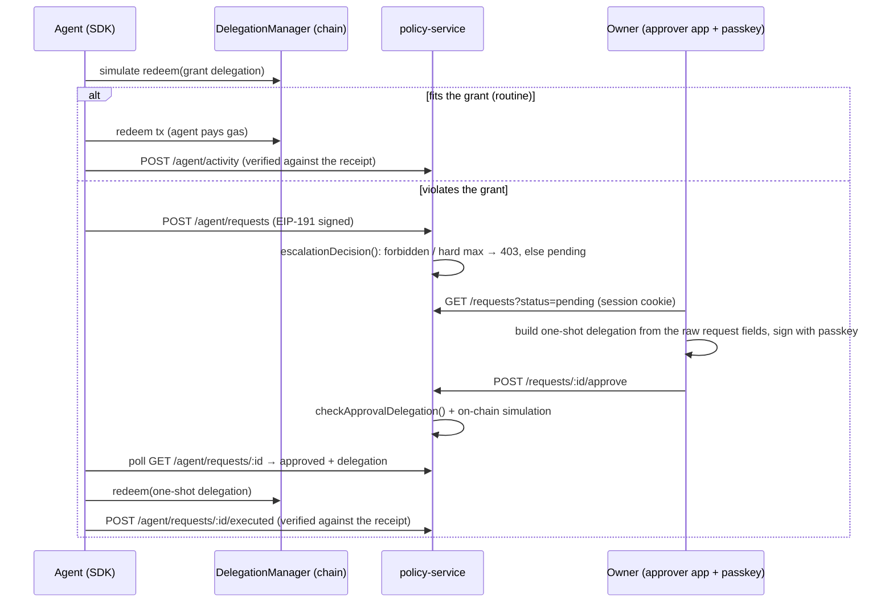

# ADR 0004: Escalation and passkey approval flow

- Status: Accepted (Phase 2)
- Date: 2026-11-20
- Code: `apps/policy-service`, `apps/approver`, `packages/sdk/src/{agent,approval}.ts`

## Flow

The one-shot approval is `ExactExecution(to, value, data)` + `LimitedCalls(1)` + `Timestamp(≤ request expiry)`, signed by
the passkey and redeemed by the agent's EOA. No bundler or relayer is involved in approvals.

## Trust model: what a compromised policy service can and cannot do

| It can                                          | It cannot                                                                                                                              |
| ----------------------------------------------- | -------------------------------------------------------------------------------------------------------------------------------------- |
| Withhold or delay requests/approvals (liveness) | Move funds: it holds no key with authority over the account                                                                            |
| Refuse to escalate                              | Widen a grant: grants are on-chain caveats signed by the passkey                                                                       |
| Show stale activity                             | Forge an approval: approvals need a passkey signature, verified on-chain (ERC-1271 → P-256)                                            |
|                                                 | Make the owner sign something other than what's shown: the approver builds the delegation from the raw fields it displays, client-side |
|                                                 | Stop revocation: revoke is a passkey-signed userOp sent to a bundler (or via the recovery EOA, ADR 0003)                               |

Remaining risk: the approver app is served by whoever hosts it. A malicious frontend could display one thing and
sign another. Mitigation for now: self-host. Later: a pinned/IPFS build or a wallet-side display of the decoded delegation.

## Authentication

- **Owner:** WebAuthn passkey (`@simplewebauthn/server`, ES256 only, user verification required). The first passkey
  registered becomes the owner, and registration then closes (single-owner, self-hosted MVP). Sessions are random
  32-byte tokens, stored hashed, in an HttpOnly + SameSite=Strict cookie. The approver proxies `/api` so the cookie is
  first-party. When linking a smart account, the service checks **on-chain** that the account has this passkey as a
  signer (`HybridDeleGator.getKey`).
- **Agent:** every request carries `x-phos-agent/timestamp/nonce/signature`: EIP-191 over
  `method, path, timestamp, nonce, sha256(body)`, a ±5 min window, and signatures remembered against replay. The nonce
  exists because ECDSA is deterministic: identical requests in the same second would otherwise collide.
- `no_grant` denials are not written to the named account's activity log. Otherwise any agent could spam any owner.

## Fork vs live

- The browser needs to submit passkey-signed userOps (deploy, revoke). **Live:** a public ERC-4337 bundler
  (`NEXT_PUBLIC_BUNDLER_URL`, Pimlico public endpoint by default). **Fork:** the policy service's `/dev/relay`
  submits via `EntryPoint.handleOps` from an in-memory relayer key. It exists only when the RPC is an actual anvil
  node (checked with `anvil_nodeInfo`, not just a config flag), and it can't alter what the passkey signed.
- Running Pimlico's open-source bundler (Alto, GPL-3.0) locally against anvil would make the two paths identical.
  The sandbox in this environment blocked launching it as a background process. Revisit in Phase 3.

## Verified

- `pnpm e2e`: HTTP-level flow on a fork with a software authenticator (routine, escalate/approve/redeem-once,
  forbidden, hard max, reject, revoke).
- `pnpm e2e:browser`: the same through the real UI in Chromium with Chrome's virtual WebAuthn authenticator
  (passkey registration, passkey-signed deployment, grant, approval, revoke).
- 26 unit tests for the queue, auth and approval checks.

## Not done / known limitations

- Polling, not push (in-app badge + optional browser Notification). Web push later.
- Escalation only for kinds the compiler supports (`nativeTransfer`). ERC-20 and contract calls come in Phase 3.
- Approval UX signs one delegation per approval: one passkey prompt each. Batch approvals later.
- On live, the account pays its own userOp gas (no paymaster). An empty account can't revoke via the bundler. Use
  the recovery EOA (ADR 0003), or add a paymaster.
